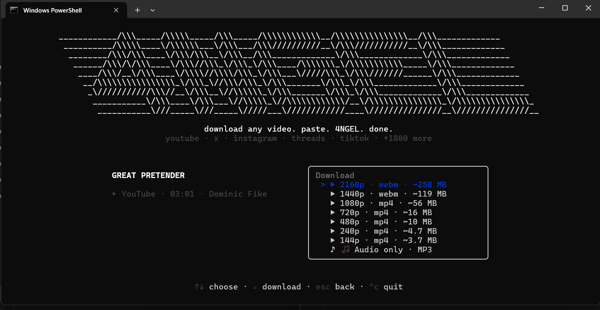

@"
# 4NGEL

<div align="center">


**4NGEL** - CLI video downloader with beautiful Terminal User Interface

[](LICENSE)
[](https://nodejs.org/)
[](http://makeapullrequest.com)

</div>

---

## ✨ Features

- 🎬 **Download videos** from YouTube, X, Instagram, Threads, TikTok
- 🎵 **Extract audio** as MP3
- 🎨 **Beautiful TUI** with keyboard navigation
- 📊 **Real-time progress bar**
- 📋 **Clipboard support** (paste URL automatically)
- 🌓 **Auto theme** (adapts to your terminal)
- 🚀 **Supports 1800+ sites** via yt-dlp
- 🖱️ **Mouse support** (click to select)
- 📁 **Downloads to ~/Downloads** folder

---

## 📸 Screenshots

### Main Interface


### Quality Selection


### Download Progress


### Download Complete


---

## 🚀 Quick Start

### Prerequisites

- **Node.js** >= 18.0.0 ([Download](https://nodejs.org/))

### Installation

```bash
# Clone the repository
git clone https://github.com/TR1ST4N226/4NGEL.git
cd 4NGEL

# Install dependencies
npm install

# Build the project
npm run build
