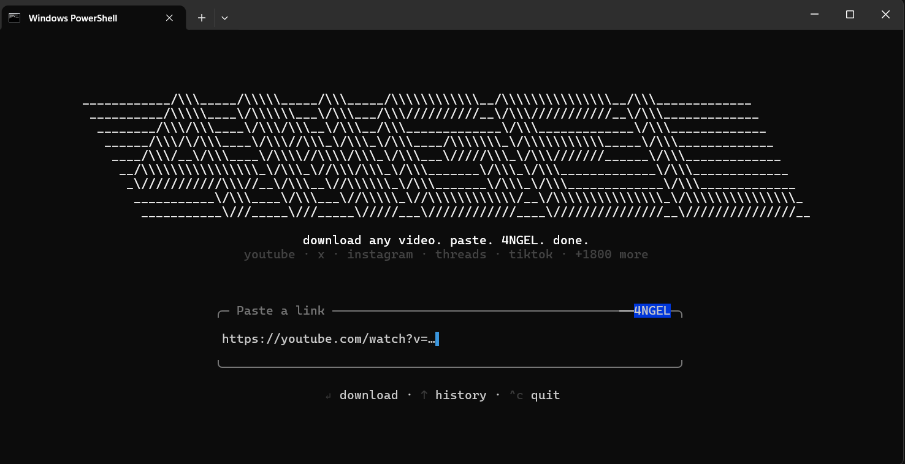
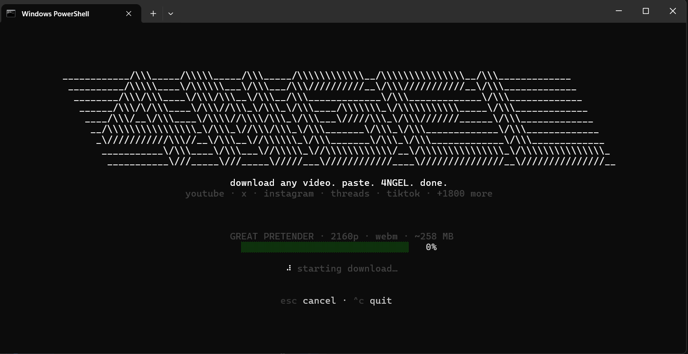

<div align="center">

# 4NGEL

**CLI video downloader with a beautiful Terminal User Interface**

[](LICENSE)
[](https://nodejs.org/)
[](http://makeapullrequest.com)

</div>

---

## ✨ Features

- 🎬 **Download videos** from YouTube, X, Instagram, Threads, TikTok
- 🎵 **Extract audio** as MP3
- 🎨 **Beautiful TUI** with keyboard navigation
- 📊 **Real-time progress bar**
- 📋 **Clipboard support** (auto-paste URL)
- 🌓 **Auto theme** (adapts to your terminal)
- 🚀 **1800+ sites supported** via yt-dlp
- 🖱️ **Mouse support** (click to select)
- 📁 **Downloads** to your `~/Downloads` folder

---

## 📸 Screenshots

### Main Interface


### Quality Selection


### Download Progress


### Download Complete


---

## 🚀 Quick Start

### Windows portable release

For the easiest setup, download `4NGEL-Portable-Windows-x64-vX.Y.Z.zip` from
[GitHub Releases](https://github.com/TR1ST4N226/4NGEL/releases), extract it, and
double-click `4NGEL.exe`. The launcher displays the included custom icon and
starts `4ngel.bat`. No separate Node.js or npm installation is required.
The portable archive supports 64-bit Windows only and does not require
administrator access.

You can also run `4ngel.bat` directly, including with a URL argument.

The archive includes the Node.js runtime, production dependencies, FFmpeg,
yt-dlp, and Deno. On first launch, 4NGEL copies the bundled yt-dlp into your
user profile and then checks for updates automatically. An internet connection
is still required for yt-dlp updates and media downloads. Browser cookies are
read from your local browser profile and are never included in the archive.
Runtime versions and third-party notices are included in the extracted folder.

The portable ZIP is built and attached automatically after a GitHub Release is
published; allow the release workflow a few minutes to finish before looking for
the ZIP asset.

### Prerequisites

These prerequisites apply only when building or running the source archive:

- **Node.js** >= 18.0.0 ([Download](https://nodejs.org/))
- **.NET Framework C# compiler** to generate the iconed `4NGEL.exe` launcher;
  if unavailable, the source version remains usable through `4ngel.bat`.

### Installation

```bash
# Clone the repository
git clone https://github.com/TR1ST4N226/4NGEL.git
cd 4NGEL

# Install dependencies
npm install

# Build the project
npm run build
```

### Usage

For a source download, double-click `4ngel.bat` (Windows). On first launch, the
launcher installs dependencies, builds the CLI, and creates `4NGEL.exe` with
the included icon. After setup, you can double-click `4NGEL.exe` for normal
launches. This requires Node.js >= 18, the .NET Framework C# compiler, and an
internet connection. You can also run:

```bash
# With a URL directly (the batch launcher accepts arguments)
4ngel.bat https://youtube.com/watch?v=...

# Without a URL (you'll be prompted)
4ngel.bat
```

### YouTube cookies (optional)

The Windows launcher automatically uses the default Opera GX profile when it
finds one. For another supported browser, set `YT_DLP_COOKIES_FROM_BROWSER`
before launching 4NGEL. To save that choice for future terminals, run this once
in PowerShell (replace `chrome` with `edge`, `firefox`, or another yt-dlp browser):

```powershell
[Environment]::SetEnvironmentVariable("YT_DLP_COOKIES_FROM_BROWSER", "chrome", "User")
```

Open a new terminal after setting it. Cookies stay on the local machine and are
never stored in the repo. The portable Windows archive includes Deno. Source
installs need [Deno](https://deno.com/) installed separately so yt-dlp can solve
YouTube JavaScript challenges. Some age-restricted videos may still require a
PO Token Provider. If the browser cookie database is locked, 4NGEL retries
without cookies; close Opera GX first when you need its signed-in session.

### yt-dlp updates

4NGEL checks its managed yt-dlp binary for updates once every 24 hours and
automatically installs the latest stable version. If yt-dlp is found on `PATH`,
it is managed externally and should be updated with its package manager.
In the portable Windows archive, the bundled yt-dlp is copied to 4NGEL's user
data folder on first use; subsequent daily checks update that managed copy.

---

## 🎮 Keyboard Shortcuts

| Key          | Action                        |
|--------------|--------------------------------|
| ↑ / ↓        | Navigate through formats       |
| ↵ (Enter)    | Download / Select              |
| Esc          | Go back / Cancel               |
| Ctrl+C       | Quit                           |

---

## 📦 Supported Sites

YouTube · X (Twitter) · Instagram · Threads · TikTok · Vimeo · Twitch · Facebook · Reddit · Dailymotion · VK · Bilibili · SoundCloud · Bandcamp · **+1800 more**

> Powered by [yt-dlp](https://github.com/yt-dlp/yt-dlp)

---

## 🛠️ Development

```bash
# Clone and install
git clone https://github.com/TR1ST4N226/4NGEL.git
cd 4NGEL
npm install

# Development mode (auto-rebuild)
npm run dev

# Build
npm run build

# Type check
npm run typecheck

# Build the self-contained Windows x64 ZIP (Windows only)
npm run package:windows
```

The portable ZIP is written to `artifacts/`. It bundles the Node.js runtime,
production npm dependencies, FFmpeg, yt-dlp, and Deno. Its included
`portable-runtime.json` records the bundled runtime versions.

### Project Structure

```
4NGEL/
├── src/
│   ├── app.tsx          # Main application
│   ├── cli.tsx           # CLI entry point
│   ├── theme.tsx          # Theme system
│   ├── components/        # UI components
│   └── lib/               # Core libraries
├── 4ngel.bat              # Windows launcher
├── scripts/               # Release packaging scripts
├── tests/                 # Automated tests
├── package.json
├── tsconfig.json
└── tsup.config.ts
```

---

## 🎯 Technologies Used

- [Ink](https://github.com/vadimdemedes/ink) — React for terminal UI
- [React](https://react.dev/) — UI framework
- [yt-dlp](https://github.com/yt-dlp/yt-dlp) — Video downloading
- [TypeScript](https://www.typescriptlang.org/) — Type safety
- [tsup](https://tsup.egoist.dev/) — Build tool

---

## 🤝 Contributing

1. Fork the repository
2. Create your feature branch (`git checkout -b feature/amazing-feature`)
3. Commit your changes (`git commit -m 'Add some amazing feature'`)
4. Push to the branch (`git push origin feature/amazing-feature`)
5. Open a Pull Request

---

## 📄 License

This project is licensed under the MIT License - see the [LICENSE](LICENSE) file for details.

---

## 🙏 Credits

- [yt-dlp](https://github.com/yt-dlp/yt-dlp) for video downloading
- [Ink](https://github.com/vadimdemedes/ink) for the terminal UI
- Inspired by [yoinks](https://github.com)

<div align="center">

Made with ❤️ by **TR1ST4N226**

⭐ *Star this repo if you find it useful!*

</div>
